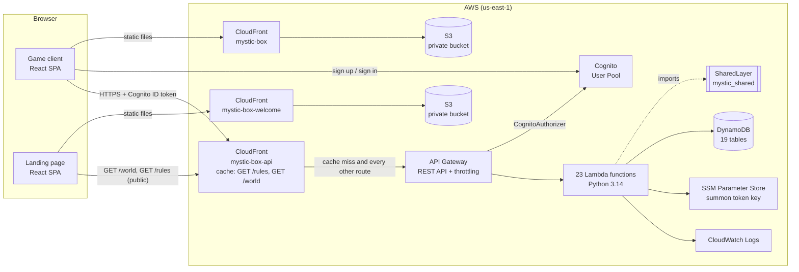

# Mystic Box

Mystic Box is a card-summoning web game. This repository is a monorepo with everything needed to build, run and deploy it: the game client, the serverless backend, the public landing page and the infrastructure (as code) behind all three.

This README covers **how the project is built**: the architecture, what each folder does, how to run it locally, test it and deploy it. It does not explain the game itself; the rules are served by the API (`GET /rules`) and shown in-game in the Grimoire.

| App | Folder | Stack | URL |
| --- | --- | --- | --- |
| Game client | [`mystic-box/`](mystic-box/) | React + Vite, hosted on S3 + CloudFront | `https://mystic-box.geskee.com.br` |
| Backend API | [`mystic-box-back/`](mystic-box-back/) | AWS SAM: CloudFront + API Gateway + Lambda (Python) + DynamoDB + Cognito | `https://mystic-box-api.geskee.com.br` |
| Landing page | [`mystic-box-welcome/`](mystic-box-welcome/) | React + Vite, hosted on S3 + CloudFront | `https://mystic-box-welcome.geskee.com.br` |

---

## Table of contents

- [Core principle: the server owns the game](#core-principle-the-server-owns-the-game)
- [Architecture](#architecture)
- [Repository layout](#repository-layout)
- [Backend (`mystic-box-back/`)](#backend-mystic-box-back)
- [Game client (`mystic-box/`)](#game-client-mystic-box)
- [Landing page (`mystic-box-welcome/`)](#landing-page-mystic-box-welcome)
- [Infrastructure and deployment](#infrastructure-and-deployment)
- [Running locally](#running-locally)
- [Testing and CI](#testing-and-ci)
- [Monitoring](#monitoring)
- [Contributing](#contributing)

---

## Core principle: the server owns the game

Every game rule lives in the backend. The clients only **display** what the API returns and **send intents** to it.

- **No game logic in the frontend.** Prices, rarities, drop rates, draws, rewards, balances, cooldowns, limits and validations are all computed and enforced in a Lambda.
- **Client data is never trusted.** Requests carry only the player's intent and identifiers (a `listingId` to buy, a signed `summonToken` to keep a draw). Names, rarities, prices and amounts are always read on the server; fields like `price` or `rarity` sent by a client are ignored. The only free value a player picks is the asking price of a market listing, and even that is validated against the rarity's allowed range.
- **Everything the UI shows comes from the API.** The client does not keep copies of rule tables; even the help pages (`GET /rules`) are generated from the same constants the Lambdas use.
- **Multi-item changes are atomic.** Anything that touches more than one record (buying a listing, keeping a draw, ascending a card, forging a relic, finishing a battle) runs as a single DynamoDB `TransactWriteItems` with conditions, so nothing can be duplicated or applied twice.
- **What the frontend may own:** presentation only. Layout, animations, sound, copy, ordering, and visual effects derived from the data the API returned.

Since there is no way to guarantee that only our client calls the API, protection comes from four layers: rules on the server, an authenticated user on every player route, a CloudFront cache in front of the public routes, and request throttling at API Gateway.

---

## Architecture



### Request lifecycle

1. **Static assets.** The browser downloads the SPA from CloudFront. The S3 buckets are private and readable only by their distribution (Origin Access Control). Hashed files under `assets/` are cached for a year; `index.html` is `no-cache`, and CloudFront returns `index.html` for any unknown path so client-side routes work on reload.
2. **Authentication.** The game client signs players in against the Cognito User Pool (`amazon-cognito-identity-js`) and sends the ID token in the `Authorization` header. The player is identified on the server by the token's `sub` claim.
3. **API CloudFront.** Both clients call the API at `https://mystic-box-api.geskee.com.br` (`ApiDistribution` in the backend stack, output `ApiUrl`). `GET /rules` and `GET /world` are public and identical for everyone, so they are cached for as long as the Lambda's `Cache-Control` allows; within that window CloudFront answers on its own and the request never reaches API Gateway or its rate limits. Every other route passes through uncached, forwarding `Authorization`, body and query string, and error responses are never cached. The raw `execute-api` endpoint is still reachable directly (closing it is tracked in [issue #100](https://github.com/gesitaric/mystic-box/issues/100)).
4. **API Gateway.** Every player route is protected by the `CognitoAuthorizer`; only `GET /rules` and `GET /world` are public. `MethodSettings` set a default rate limit for all routes plus lower limits on expensive ones (e.g. `POST /box/open`, `GET /users/search`). These limits are shared by all players (they are not per user or per IP). Above a limit, API Gateway answers `429` without invoking a Lambda, which caps cost. `GatewayResponses` add CORS headers to `401` and `429` so the browser can read them.
5. **Lambda.** Each route (or small group of related routes) has its own function. Handlers stay thin: they parse the request, load state from DynamoDB, call the rules in the shared layer, and write the result back.
6. **DynamoDB.** State lives in on-demand tables, one per concern (collection, wallet, market listings, battles, PvP, progress...). Writes that span several items use transactions with condition expressions; battle state is versioned and every save is conditional on the version read.
7. **Logs.** Each Lambda writes JSON logs to its own CloudWatch log group with a retention period. X-Ray is off and `SystemLogLevel: WARN` drops the START/END/REPORT lines to keep log costs down.

### Notable design patterns

- **Shared rules layer.** All game rules live in one Python package (`mystic_shared`) published as a Lambda Layer, so every function uses the same definitions and nothing is duplicated.
- **One draw per cooldown.** `POST /box/open` checks the summon cooldown, draws on the server and starts the cooldown right away. The draw is stored as the player's pending summon in `UserSummonStateTable`; opening the portal again while it is pending returns the same cards, so a player cannot draw many times and keep only the best result. The response carries an HMAC-signed `summonToken` (key in an SSM `SecureString`, created outside the template) bound to the player. To keep the cards, the client sends back only that token; in a single transaction the server checks it is the player's pending summon (and clears it), marks it as used and stores the cards. `GET /users/me/summon-status` also returns the pending summon, so a draw opened on another device can still be kept.
- **Polling instead of sockets.** Online duels, the lobby presence list, spectating and emoji reactions use short HTTP polling with cursors (`since`, `reactionsSince`) and `unchanged` responses, which keeps the stack fully serverless with no connection management.
- **TTL and sparse indexes.** Presence, challenges and reactions expire through DynamoDB TTL. Live duels are listed through a sparse GSI whose key exists only while the duel is active.

---

## Repository layout

```text
.
├── .github/workflows/        CI: tests on every PR, Linux screenshot refresh
├── CLAUDE.md                 Detailed project conventions and current flows (Portuguese)
├── mystic-box/               Game client (React + Vite) and its hosting infra
├── mystic-box-back/          Serverless backend (AWS SAM)
└── mystic-box-welcome/       Public landing page and its hosting infra
```

Each app has its own README with deeper, app-specific instructions. [`CLAUDE.md`](CLAUDE.md) is the most detailed reference for conventions and every current flow (written in Portuguese).

---

## Backend (`mystic-box-back/`)

An AWS SAM application. [`template.yaml`](mystic-box-back/template.yaml) declares the whole backend: the REST API and the CloudFront distribution in front of it (with its DNS records), the Cognito User Pool and client, every Lambda, the shared layer, the DynamoDB tables and the log groups.

```text
mystic-box-back/
├── template.yaml             SAM/CloudFormation template for the backend stack
├── samconfig.toml            sam deploy settings (stack "mystic-box-back")
├── shared/mystic_shared/     Lambda Layer with ALL game rules (see below)
├── <function_name>/          One folder per Lambda: app.py (handler) + requirements.txt
├── events/                   Sample invocation events for sam local invoke
├── local/                    Local dev environment and production monitoring
│   ├── dev_server.py         Runs every Lambda in one Python process, reading template.yaml
│   ├── docker-compose.yml    DynamoDB Local (+ optional Grafana profile)
│   └── monitoring/           Grafana dashboards/datasources reading production CloudWatch
└── tests/
    ├── unit/                 pytest suite (in-memory fake DynamoDB, no AWS calls)
    └── integration/          Tests against a deployed API Gateway
```

### The shared layer (`shared/mystic_shared/`)

The single source of truth for game rules. Any Lambda that needs them declares `Layers: [!Ref SharedLayer]` and imports from `mystic_shared`.

| Module | Responsibility |
| --- | --- |
| `cards.py` | Card catalog (name, rarity, image file, element, archetype), market limits, draw weights and summon size |
| `summon_token.py` | HMAC-signed summon token and lookup of the player's pending draw |
| `stats.py` | Battle stats derived from rarity, archetype and level; elements and archetypes |
| `battle.py` | Turn-based battle engine (PvE and PvP): skills, effects, AI, difficulties, bonds, rivalries, sudden death |
| `pvp.py` | Online duel rules: challenges, turn timer, abandonment, presence, live duel list, spectators, reactions |
| `progression.py` | Experience curve, level cap and level-up rewards |
| `ascension.py` | Card ascension using duplicate copies |
| `relics.py` | Equippable relics, attunement, forge cost |
| `lore.py` | World, regions, character stories, bonds, rivalries, secrets, chronicle |
| `campaign.py` | Map campaign stages, enemies and first-clear rewards |
| `mastery.py` | Per-region collection rewards |
| `omens.py` | Weekly rotating featured region |
| `titles.py` | Profile titles and how they are earned |
| `usernames.py` | Username validation, change cooldown, player search |
| `rules.py` | Builds the public rules payload (`GET /rules`) from the constants above, never duplicating values |

### Lambda functions

Each folder holds one handler. Grouped by feature:

| Area | Folders | Routes (summary) |
| --- | --- | --- |
| Summon | `open_box`, `save_user_card`, `get_summon_status` | `POST /box/open`, `POST /users/me/cards`, `GET /users/me/summon-status` |
| Collection | `get_user_cards`, `ascend_card`, `relics` | `GET /users/me/cards`, `POST /users/me/cards/ascend`, `/users/me/relics[/forge\|/equip]` |
| Economy and market | `get_wallet`, `shop_listings`, `create_listing`, `buy_listing`, `cancel_listing`, `buy_orders` | `GET /users/me/wallet`, `GET\|POST /shop/listings`, `POST /shop/listings/{id}/buy\|cancel`, `GET /shop/history`, `POST /shop/orders`, `POST /shop/orders/{id}/fill\|cancel` |
| Profile | `get_profile`, `set_username`, `set_title`, `search_users` | `GET /users/me/profile`, `POST /users/me/username\|title`, `GET /users/search` |
| PvE battles | `get_battle`, `play_battle`, `get_campaign`, `claim_region` | `GET /battles/current`, `POST /battles`, `POST /battles/current/actions`, `GET /users/me/campaign`, `POST /users/me/regions/claim` |
| Online duels | `pvp_challenges`, `pvp_battle` | `GET /pvp`, `/pvp/challenges/*`, `/pvp/battle*`, `/pvp/watch`, `/pvp/leave` |
| Public | `get_rules`, `get_world` | `GET /rules`, `GET /world` (no auth) |

### Data (DynamoDB)

All tables use on-demand billing and are keyed by player (`userId`) wherever the data belongs to a player. Main groups:

- **Collection and summons:** `UserCardsTable`, `UserSummonStateTable`, `SummonTokensTable`, `CardsTable`
- **Economy:** `UserWalletTable`, `ShopListingsTable`, `BuyOrdersTable`, `MarketSalesTable` (price history, TTL)
- **Progression:** `UserProgressTable`, `CardAscensionsTable`, `UserRelicsTable`, `CardRelicsTable`, `RegionProgressTable`
- **Profiles:** `UserProfilesTable` (with the `UsernameSearchIndex` prefix-search index), `UsernamesTable` (one owner per name)
- **Battles:** `BattlesTable`, `PvpChallengesTable`, `PvpBattlesTable` (with the sparse `LiveDuelsIndex`), `PvpPlayersTable`, `PvpPresenceTable`, `PvpReactionsTable`

### Conventions for new backend code

- A new Lambda gets `Layers: [!Ref SharedLayer]`, its own `AWS::Logs::LogGroup` with `RetentionInDays` (referenced from `LoggingConfig`), and an entry in the Grafana dashboard's log group list (a unit test checks this).
- A new player route declares `Auth: Authorizer: CognitoAuthorizer` and, if expensive, its own throttling entry in `MethodSettings`.
- A new public route whose response is the same for everyone can be cached: send `Cache-Control` from the Lambda and add its path to the `CacheBehaviors` of `ApiDistribution`. Routes with login are never cached (`tests/unit/test_api_cache.py` checks this).
- A new card needs a story, a secret chapter, last words and at least one bond in `lore.py` (a unit test checks this).

---

## Game client (`mystic-box/`)

A React 19 single-page app built with Vite. It never computes game rules: it renders API responses and animates the `events` returned by battle actions.

```text
mystic-box/
├── src/
│   ├── main.jsx, Root.jsx, App.jsx   Entry point, session handling and screen composition
│   ├── routes.js                     URL ⇄ screen/panel mapping (parseLocation / formatRoute)
│   ├── navigation.js, router.js      Browser history integration and React hooks (useRoute, navigate, exitTo)
│   ├── auth/cognito.js               Cognito sign-up / sign-in / session
│   ├── components/                   Screens and panels (collection, shop, grimoire, world map, profile...)
│   │   ├── battle/                   Arena: team setup, campaign, PvP lobby, battle screen, API client
│   │   ├── portal/                   Summon portal animation engine
│   │   └── reveal/                   Card reveal effects
│   ├── audio/                        Sound effects and sound preference
│   ├── assets/                       Character art, relic art, world map (SVG source + WebP)
│   └── styles/                       CSS
├── e2e/                              Playwright layout and visual regression tests
│   ├── fixtures/api/                 Recorded API responses (captured from the real local API)
│   └── __screenshots__/              Reference images per viewport, for Windows and Linux
├── infra/                            Hosting stack (S3 + CloudFront + Route 53), see infra/README.md
└── scripts/                          deploy.ps1 (build → S3 → CloudFront invalidation), image optimization
```

**Routing.** The open screen and panels come from the URL, not from loose React state, so the browser Back button works everywhere. Panels are appended to the path of the screen beneath them (e.g. `/arena/grimoire/battle`). URL parameters are only identifiers, always validated by the server. Private URLs opened without a session show the login on top and keep the requested address.

**Configuration.** The client reads `VITE_API_URL`, `VITE_COGNITO_USER_POOL_ID` and `VITE_COGNITO_CLIENT_ID` from `.env` (production, values from the backend stack outputs: `ApiUrl`, `UserPoolId`, `UserPoolClientId`) or `.env.localapi` (local API).

---

## Landing page (`mystic-box-welcome/`)

A separate React + Vite site that presents the game. It only calls the public `GET /world` and `GET /rules` endpoints, and the same core principle applies: every number on the page (odds, timers, multipliers) comes from the API. It reuses the art from `mystic-box/src/assets` directly instead of copying it.

```text
mystic-box-welcome/
├── src/
│   ├── components/      Page sections (hero, world, champions, odds, omen, chronicle, releases...)
│   ├── api.js           Public API client
│   └── releases.js      Player-facing release notes (checked by releases.test.js)
├── infra/template.yaml  Hosting stack (S3 + CloudFront + Route 53)
└── scripts/deploy.ps1   Build and publish
```

Every PR that changes something players can see adds a release note to `src/releases.js`.

---

## Infrastructure and deployment

Everything is defined as code and deployed as three independent CloudFormation stacks in `us-east-1`:

| Stack | Template | What it creates | Deploy |
| --- | --- | --- | --- |
| `mystic-box-back` | `mystic-box-back/template.yaml` | API CloudFront (`mystic-box-api.geskee.com.br`, A/AAAA records), API Gateway, Cognito, Lambdas, SharedLayer, DynamoDB, log groups | `sam build` + `sam deploy` in `mystic-box-back/` |
| `mystic-box-frontend` | `mystic-box/infra/template.yaml` | Private S3 bucket, CloudFront (OAC, security headers, SPA fallback), A/AAAA records | `sam deploy` in `mystic-box/infra/`; publish the app with `npm run deploy` in `mystic-box/` |
| `mystic-box-welcome` | `mystic-box-welcome/infra/template.yaml` | Same hosting pattern for the landing page | `npm run deploy` in `mystic-box-welcome/` (see its README) |

Shared resources that live **outside** the stacks:

- The Route 53 hosted zone `geskee.com.br` and the ACM wildcard certificate `*.geskee.com.br` (in `us-east-1`, as CloudFront requires).
- The SSM `SecureString` parameter `/mystic-box/summon-token-key`, which signs summon tokens. CloudFormation cannot create `SecureString` parameters, so it is created once with the AWS CLI (see [`mystic-box-back/README.md`](mystic-box-back/README.md)).

Deploys are run manually; CI only runs tests. Deploy the backend before the clients when a change depends on it (for example, the clients' `VITE_API_URL` points to the API CloudFront created by the backend stack).

---

## Running locally

Full guide: [`mystic-box-back/local/README.md`](mystic-box-back/local/README.md). In short:

1. **Database.** From `mystic-box-back/`: `docker compose -f local/docker-compose.yml up -d` starts DynamoDB Local on `localhost:8000`.
2. **API.** From `mystic-box-back/`: `python local/dev_server.py` (using the project's virtualenv) serves every Lambda on port `3000`. It reads routes, environment variables and tables from `template.yaml`, so new functions, tables and indexes show up automatically. Throttling limits do not apply locally.
3. **Game client.** From `mystic-box/`: `npm run dev:local` (copy `.env.localapi.example` to `.env.localapi` first).

`sam local start-api` is not recommended because it does not apply the Cognito authorizer.

---

## Testing and CI

| Scope | Command (from the app folder) |
| --- | --- |
| Backend | `python -m pytest tests/unit` (in `mystic-box-back/`) |
| Game client | `npx eslint src` and `npx vite build` |
| Game client UI | `npm run test:ui` (Playwright on installed Microsoft Edge) |
| Landing page | `npx eslint src`, `npm test` and `npx vite build` |

**Unit tests** run the real handlers against an in-memory fake DynamoDB (`tests/unit/fake_dynamo.py`) with a test signing key; nothing calls AWS.

**UI tests** need neither the database nor the API: `e2e/support.js` answers requests with recorded responses from `e2e/fixtures/api`, injects a fake Cognito session and freezes the clock. Every screen in `e2e/screens.js` is checked at four viewports (360x640, 393x852, 820x1180, 1440x900):

- `layout.spec.js` checks there is no horizontal scroll, no clipped or overflowing controls, the open panel fits, and every API request has a recorded response.
- `visual.spec.js` compares screenshots against references kept per OS (`-win32` locally, `-linux` in CI), since fonts render differently.

Fixtures are captured from the real local API with `e2e/fixtures/capture.mjs`, never written by hand.

**GitHub Actions** ([`.github/workflows/`](.github/workflows/)):

- `tests.yml` runs on every PR to `main`: backend pytest, client lint + build, client UI tests (report uploaded as an artifact on failure), and landing page lint + tests + build.
- `screenshots.yml` regenerates the Linux reference screenshots when a PR gets the `atualizar-imagens` label, commits them to the branch and removes the label.

---

## Monitoring

An optional local Grafana (`docker compose -f local/docker-compose.yml --profile monitoring up -d grafana`, then `http://localhost:3001`) reads production CloudWatch through a read-only IAM user. Dashboards are provisioned from `mystic-box-back/local/monitoring/grafana/` and pick up new Lambdas and tables automatically by stack name. Per-route API metrics stay disabled on purpose because they are billed. Requests for `/rules` and `/world` answered from the CloudFront cache never reach API Gateway, so they do not show up in its request counts; the API CloudFront is not on the dashboard. Details and costs: [`mystic-box-back/local/monitoring/README.md`](mystic-box-back/local/monitoring/README.md).

---

## Contributing

- Work flows from a GitHub issue → a branch created from the issue (based on `main`) → a pull request to `main`.
- Keep game rules in `mystic-box-back/shared/mystic_shared/`; the clients stay presentation-only.
- Intentional visual changes require updating the reference screenshots for both Windows (`npm run test:ui:update`) and Linux (the `atualizar-imagens` label).
- See [`CLAUDE.md`](CLAUDE.md) for the complete set of conventions.
